# AlphaGo User Guide

_Last updated 15 October 2026. Screenshots use example data. An online copy you can comment on: [AlphaGo User Guide](https://claude.ai/code/artifact/f3e8b974-8270-4943-9708-a60def579acd)._

## 1. What AlphaGo is

AlphaGo is a Windows desktop workstation for WorldQuant BRAIN consultants. It finds promising data, generates FASTEXPR alphas with an AI model of your choice (Gemini, Claude, OpenAI or a local Ollama model) and templates, and simulates them through the official BRAIN API. It then optimises near misses, runs BRAIN's own submission check, and submits **only when you click Submit to BRAIN** in a confirmation box.

It is a local, single-user app:

- Your BRAIN password and AI provider keys (Gemini, Anthropic, OpenAI) live only in Windows Credential Manager (service `AlphaGo`).
- Every alpha, simulation and task is kept in a local SQLite database (alphago.db), and your settings in settings.json, both in `%APPDATA%\AlphaGo`.
- Only BRAIN and the AI provider you chose are contacted, plus Yahoo Finance when you test an SPC prompt (tickers and dates only). With a local Ollama model, AI prompts never leave your PC.

### What's new on 15 October 2026

- **Any AI model.** On **LLM Integration**, choose Gemini, Claude (Anthropic), OpenAI (or any OpenAI-compatible server) or a local Ollama model. One provider is active at a time; Gemini stays the default.
- **Sync everything for scope no longer hangs.** It used to stop at "25 datasets"; field pages are now also fetched four at a time.
- **Sync my alphas works past 1,000 alphas.** BRAIN lists at most 1,000 alphas per request, so AlphaGo now reads larger accounts in date windows.

> **The one rule to remember:** AlphaGo never submits an alpha by itself, in any mode. Every submission starts with your click on **Submit to BRAIN** in the confirmation box. (Retrying a failed Submit job on Tasks re-sends that same confirmed submission.)

### What it can do

| You want to… | AlphaGo does it on… |
| --- | --- |
| Sign in to BRAIN (including biometric verification) and load the settings your account may use | Sync with BRAIN |
| Download operators, datasets and fields, so expressions are checked locally before they cost quota | Sync with BRAIN |
| Know which datasets to research next, rated by AI for Single, Double and Interaction use | Dataset Intelligence |
| Turn a dataset into ideas (AI or templates) and simulate the ones you leave ticked; double-click a field to probe it | Dataset Intelligence |
| Test your own expressions or a template across a grid of settings, with a robustness heatmap | Simulation Matrix |
| Run large systematic searches (Search Lab, Double dataset · Pair, Interaction) on their own share of BRAIN's 8 slots | Tasks |
| Have research planned for you each day, with your approval (Assisted) or without it (Full Autopilot) | Alpha Autopilot |
| Review results, run BRAIN's check, optimise, chart PnL, write descriptions and submit | Alphas (alpha details window) |
| Track your Genius level and pyramids, and find alphas that light a new pyramid | Genius AI |
| Allocate weekly Osmosis points and check the points now on BRAIN for mistakes | Osmosis, Osmosis Review |
| Pick and tag the month's Power Pool alphas | Power Pool |
| Estimate which submitted alphas may fade out of sample | Out of Sample |
| Build and test Systematic Predictions Challenge prompts | SPC Lab |
| Build, simulate and submit a Super Alpha | Super Alphas |
| See what happened, what worked and how many AI calls you used | Research History, Analytics, Dashboard |
| Choose the AI provider (Gemini, Claude, OpenAI or Ollama), choose models and edit prompt templates | LLM Integration |

### Limits it respects for you

| Limit | Default | Where it comes from |
| --- | --- | --- |
| Concurrent simulation slots | 8 | BRAIN consultant limit (`brain.max_slots`) |
| Alphas per multi-simulation | 10 | BRAIN (`brain.multi_size`) |
| Simulations never spent each day | 200 | AlphaGo reserve (`brain.quota_reserve`) |
| Regular submissions per day | 4 | `programs.daily_regular_submissions` |
| Super Alpha submissions per day | 1 | `programs.daily_super_submissions` |
| Full Autopilot simulations per day | 500 | **Daily Autopilot cap** on Alpha Autopilot |
| AI calls per day (cloud providers; local Ollama calls are not counted) | 400 | **Daily call budget** on LLM Integration |
| Data-field requests at once during a catalogue sync | 4 | `brain.catalog_concurrency` |

Sharpe and fitness limits come from BRAIN's own check results; AlphaGo's built-in values are used only when BRAIN gives none. Turnover pass or fail always comes from BRAIN's check.

## 2. Install, start and close

Double-click `dist\AlphaGo\AlphaGo.exe` and the window opens in a few seconds. Nothing else needs installing on Windows 10 or 11.

### What you need

| Item | Detail |
| --- | --- |
| Windows | Windows 10 or 11 with the Microsoft Edge WebView2 runtime (preinstalled on current Windows) |
| BRAIN account | A consultant login. AlphaGo uses the official API only |
| An AI provider (optional but recommended) | One of: a Google AI Studio key (https://aistudio.google.com/apikey); an Anthropic API key (https://console.anthropic.com); an OpenAI key, or the address of another OpenAI-compatible server; or Ollama installed on this PC (https://ollama.com) |
| Python (source install only) | 3.11 or newer; built and tested on 3.13 |

### Start the app

1. Open the AlphaGo project folder and double-click `dist\AlphaGo\AlphaGo.exe`.
2. For a desktop icon, right-click `AlphaGo.exe` and choose **Send to → Desktop (create shortcut)**.
3. The window opens at 1600 × 960 and can be shrunk to 1200 × 760.
4. If you saved your BRAIN login before, AlphaGo signs you in by itself and the **BRAIN Session** chip turns teal. If BRAIN asks for biometric verification instead, finish it on Sync with BRAIN (section 5, step 1).

**Running from the source code instead:**

```powershell
cd AlphaGo
python -m venv .venv
.venv\Scripts\python.exe -m pip install -e .[dev]
.venv\Scripts\python.exe -m alphago            # native window
.venv\Scripts\python.exe -m alphago --web      # in your browser at http://127.0.0.1:8090
```

**If the window does not open** (usually a missing WebView2 runtime), use browser mode:

1. Right-click your AlphaGo shortcut and choose **Properties**.
2. In **Target**, add `  --web ` after the closing quote, for example `"C:\…\AlphaGo.exe" --web`. Click **OK**.
3. Start AlphaGo from that shortcut. Your browser opens at http://127.0.0.1:8090. Add `--port 8091` to use another port. In browser mode AlphaGo also answers other computers on your network at that port, with no login, so use it only on a trusted network.

### Close the app

Close the window. What happens to running work:

| Work in progress | After the next start |
| --- | --- |
| Simulations already sent to BRAIN | Polling resumes, or they are re-queued |
| Simulations queued but not yet sent | Re-queued and sent as soon as you are signed in, so they spend quota without a new click. Those belonging to a research task wait with their task. To drop them, click **Cancel all queued** on **Tasks** |
| Research tasks that were running or queued | Paused with "Interrupted by an app restart". Tick them on **Tasks** and click **Resume** (or **Run All**) |
| Background jobs that were running (syncs, checks, pushes) | Marked failed ("interrupted by app restart"), or cancelled on a clean close. Click the job's row under **Jobs** on **Tasks**, then **Retry selected** (one job at a time). Jobs still waiting run by themselves |
| Autopilot AI batches | Stopped ("app closed"); simulations they had already queued still run. Press **Start** in **AI idea batches** to begin again |

In browser mode, closing the tab does **not** stop AlphaGo. Stop it with Ctrl+C in its terminal, or end `AlphaGo.exe` in Task Manager.

Run only one copy at a time. Two copies would share the same database and the same daily quota.

### Where your data lives

| What | Where |
| --- | --- |
| Research database `alphago.db`, settings `settings.json`, log `logs\alphago.log` | `%APPDATA%\AlphaGo` (paste into the Explorer address bar) |
| BRAIN email and password, AI provider keys (Gemini, Anthropic, OpenAI) | Windows Credential Manager, service `AlphaGo` |

- **Back up:** close AlphaGo normally (not from Task Manager), then copy `alphago.db` somewhere safe.
- **Test profile:** set the `ALPHAGO_HOME` environment variable to another folder before starting. It still uses the same saved BRAIN login and AI keys, so it spends the same account's quota.
- **Move to another PC:** zip the whole `dist\AlphaGo` folder and unzip it there. To keep your history, copy `alphago.db` and `settings.json` into `%APPDATA%\AlphaGo` on the new PC. Sign in and add your AI key again; credentials never travel with the files.
- **Build a fresh .exe from source:** `.venv\Scripts\python.exe scripts\build_exe.py` (add `--console` to keep a debug console).

First time? Go straight to section 5, steps 1 to 4. They take about 10 minutes and spend one simulation.

## 3. Tour of the app

The window has three parts: a header of live status chips, a sidebar with 17 pages, and the page you are on. This guide groups the pages into three sets: daily research, BRAIN programs, and records and setup (the sidebar itself is one list). Screenshots in this guide use example data.

### The window


**Header chips** (updated every second):

| Chip | What it tells you |
| --- | --- |
| 🛡 **BRAIN Session** 3h 25m | Time left in your BRAIN login. Amber under 30 minutes or when BRAIN asks for biometric verification; red **signed out**. With saved credentials AlphaGo renews the session itself |
| ⚡ **Simulations Left Today** | Remaining daily quota, from BRAIN's reply to the last simulation sent and counted down locally (5,000 is assumed until BRAIN first reports). Amber at 500 or fewer |
| ☰ **Queued · slots** | Simulations waiting, and how many of your concurrent slots (8 by default) are busy |
| **Stop all** (red) | Stops any running AI idea batch (its queued simulations are cancelled) and pauses every running or queued task and the simulation queue. Daily planning stays on; STOP AUTOPILOT on Alpha Autopilot turns it off. Nothing is deleted; **Run All** on Tasks resumes |
| ⏱ **Simulation Quota Reset in** | Time until BRAIN's daily reset (midnight New York unless BRAIN reports another time) |
| 🔍 | Jumps to **Alphas** |

**Sidebar:** click a page to open it. The number beside **Alphas** counts alphas that are `ready` and still unsubmitted. Your BRAIN user id and email sit at the bottom.

**Tables** work the same everywhere:

- Click a column header to sort; use its menu to filter; drag its edge to resize.
- Tables with a tick-box column (Alphas, Tasks, Super Alphas, the approval and ideas tables) let you select rows; the box in the header selects all.
- In most tables, double-click a row that holds an alpha to open its details window (on Power Pool a single click does it).
- Long tables show 50 rows per page.

### Research pages

#### Dashboard — today at a glance

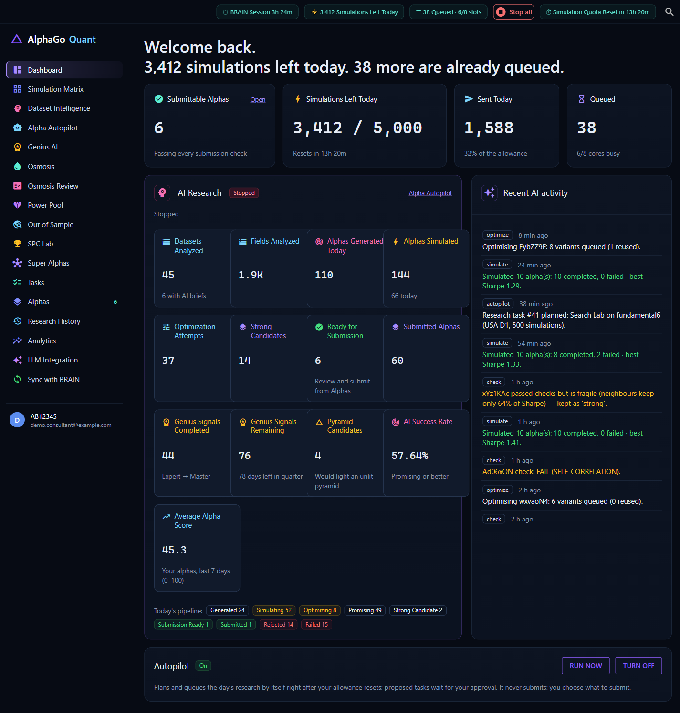

| Area | What it shows or does |
| --- | --- |
| Welcome line and four tiles | **Submittable Alphas** (with **Open**), **Simulations Left Today** (left / limit, time to reset), **Sent Today** (% of allowance), **Queued** (cores busy, pause reason) |
| **AI Research** card | 13 counters: datasets and fields in your synced catalogue (and how many datasets have AI briefs), alphas generated today, simulated (all time and today), optimisation attempts, strong, ready, submitted, Genius signals done and remaining, pyramid candidates, AI success rate (promising or better) and average score of alphas AlphaGo created in the last 7 days (see Score in the glossary) |
| **Today's pipeline** | Badges from Generated to Submitted, plus Rejected and Failed (red when not zero) |
| **Recent AI activity** | The last 40 events from every part of the app, newest first. Errors are red, warnings amber, successes green |
| **Autopilot** card | **Run now** plans the day's research tasks (Assisted: they wait for approval; Full Autopilot: they start; Manual: nothing); **Turn on / Turn off** switches daily planning after each quota reset |

#### Dataset Intelligence — where to look next

Every dataset in the chosen **Region / Delay / Universe** is rated by your AI model when you press Rate datasets with AI (datasets with synced fields only). From 20 simulations on a dataset, its score is blended 75 / 25 with your own hit rate.

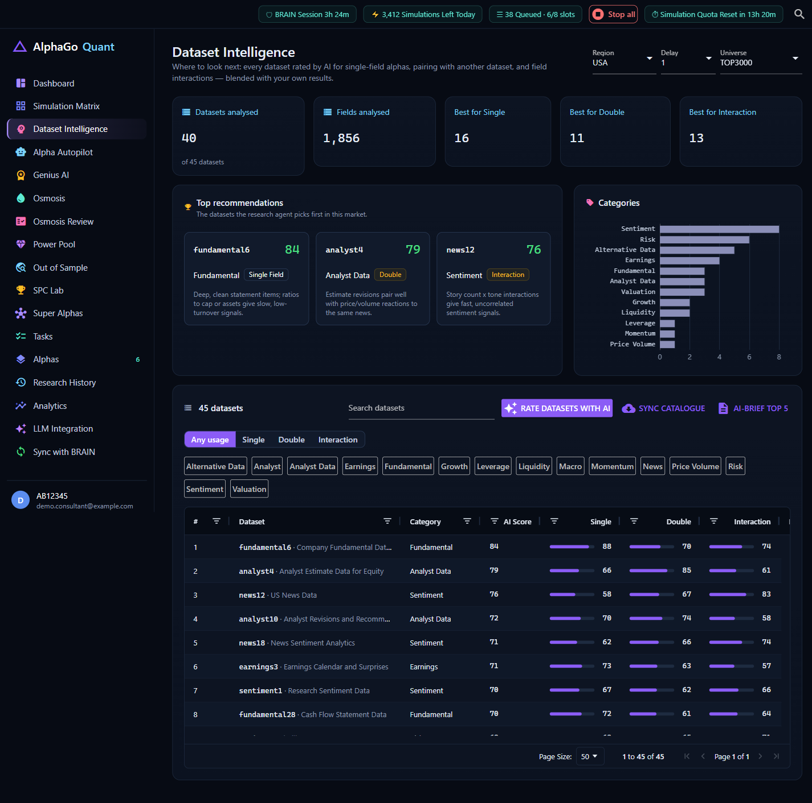

| Control | What it does |
| --- | --- |
| **Rate datasets with AI** | Background job: the AI model scores each not-yet-rated dataset 0–100 overall and for **Single**, **Double** and **Interaction** use, and gives it a recommended usage, a theme and a one-line reason |
| **Sync catalogue** | Downloads operators, datasets and fields for this scope |
| **AI-brief top 5** | Writes AI briefs for the 5 highest-Opportunity datasets that have none |
| Tiles, **Top recommendations**, **Categories** | Counts, the three highest-rated datasets (blended AI Score), and how many rated datasets fall in each theme |
| **Any usage / Single / Double / Interaction**, theme chips, search | Filter the table |
| Table columns | AI Score, usage bars, Recommended, Fields, Tested (your simulations), Pyramid ×, Opportunity |
| Click a dataset | Opens its panel: **Analyze with AI** (brief: themes, pitfalls, key fields, idea families), **Generate AI ideas**, **Template ideas** (12), **Research task…**, **Seed Autopilot** (sets the Autopilot's region, delay and universe to this scope, pins the dataset for AI idea batches and opens the Autopilot; nothing starts), and its **Fields** table |
| Double-click a field | Queues **4 probe simulations** (neutralization NONE, decay 0) to show coverage and update rate |

#### Simulation Matrix — your own expressions across a grid of settings

| Control | What it does |
| --- | --- |
| **Expressions** tab | One expression per line; multi-statement alphas with `;` are fine |
| **Template** tab | A pattern with `{field}`, `{field2}`, `{window}`, `{group}`. Type in **Search fields**, press Enter, pick **Fields (matrix-type fields)**, fill **Windows** and **Groups**. Every combination becomes one expression |
| **Settings matrix** | Region, Delay, one or more **Universes** and **Neutralizations**, comma lists of **Decays** and **Truncations**, NaN handling, Pasteurize, and **Max trade** if your account has it |
| Blue preview line | Expressions × setting combinations = simulations, and how many are left today. Red if the run would exceed today's quota |
| **Validate** | Checks every expression locally against the synced catalogue of the first universe (loosely if fields are not synced). Free |
| **Run matrix** | Validates, then queues the valid expressions in multi-simulations of up to 10, or refuses if they exceed today's remaining quota. Equivalent expression + settings already simulated are reused, not re-run. The queue still keeps the day's last 200 simulations in reserve |
| **Results** | Pick the run in **Matrix batch**. The heatmap (**Heatmap X / Y / Metric**) shows the mean Sharpe, fitness or turnover per cell: for Sharpe or fitness, a broad bright area is robust, one bright cell is usually luck |

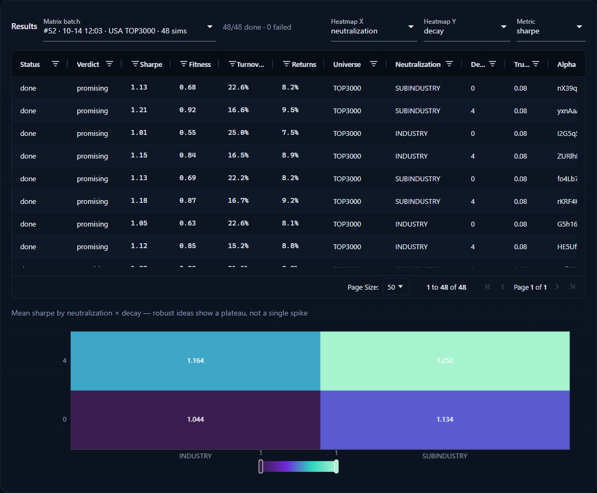

#### Alpha Autopilot — research planned for you

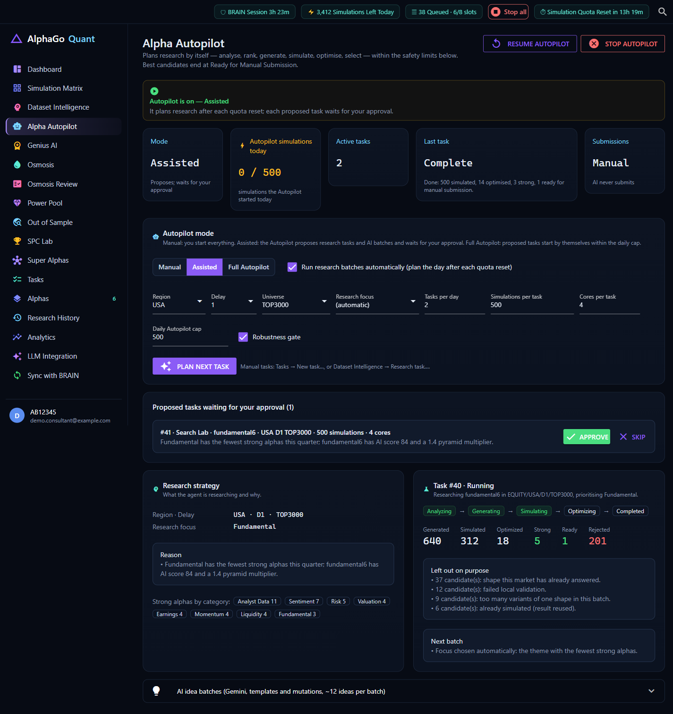

| Area | What it shows or does |
| --- | --- |
| **Resume Autopilot / STOP AUTOPILOT** | Turn daily planning on (plan today if not done yet, and resume paused Autopilot tasks) or off (and pause its tasks). Resume needs Assisted or Full mode and a BRAIN sign-in |
| Banner and tiles | Whether the Autopilot is on; **Mode**; **Autopilot simulations today** against the cap; active tasks; last task; **Submissions: Manual — AI never submits** |
| **Autopilot mode** card | **Manual / Assisted / Full Autopilot**, **Run research batches automatically**, scope, **Research focus** (a theme or automatic), **Tasks per day**, **Simulations per task**, **Cores per task**, **Daily Autopilot cap**, **Robustness gate** |
| **Plan next task** | Assisted: proposes one task for approval. Full Autopilot: starts it |
| **Proposed tasks waiting for your approval** | Each with its reason, **Approve** or **Skip**. With daily planning on, proposals not approved on their day are skipped at the next reset |
| **Research strategy** | Scope, focus, the reason for the latest plan, strong alphas by category |
| Current task card | Stage bar (Analyzing → Generating → Simulating → Optimizing → Completed), counts, **Left out on purpose** with reasons |
| **AI idea batches** (collapsed) | The older batch generator: goal, dataset strategy, batch size, rounds, quota share and the LLM / template / mutation mix. In Manual and Assisted mode each batch waits for approval in an editable table; in Full Autopilot it runs without review, within the daily cap. Every batch is listed in **Batch history** |

#### Tasks — everything that runs

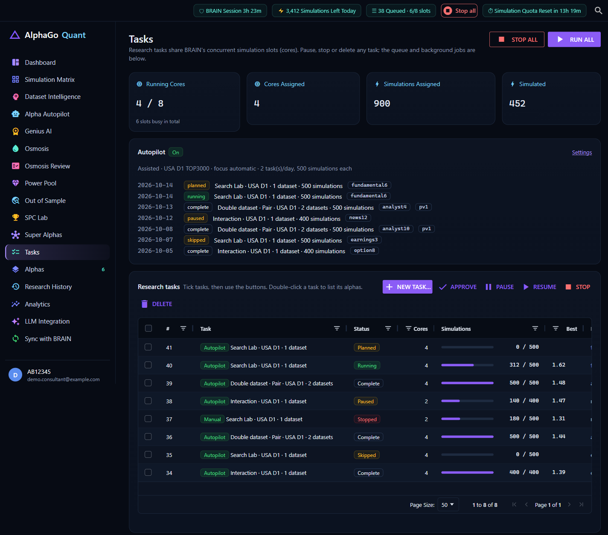

| Area | What it shows or does |
| --- | --- |
| **Stop All / Run All** | Stop All halts the AI idea batches and pauses every running task and the queue; Run All resumes the queue and every paused or queued task |
| Tiles | **Running Cores** (task simulations running / current slot limit, normally 8), **Cores Assigned**, **Simulations Assigned**, **Simulated** |
| **Autopilot** card | Mode, scope, focus, and the latest daily plans with their status |
| **Research tasks** table | Task (kind and scope, with a Manual or Autopilot badge), status, cores, a progress bar (done / planned), best Sharpe, datasets. Tick rows, then **Approve**, **Pause**, **Resume**, **Stop** or **Delete**. **New task…** creates one. Double-click a task to list its alphas, best first |
| **Simulation queue** | Queued, simulating, slots; **Pause queue / Resume queue**, **Cancel all queued** |
| **Candidate statuses** | Counts from new to cancelled |
| **Jobs** | Background jobs: syncs, checks started from Alphas, submissions, re-fetches, dataset ratings, PnL preparation, Power Pool tags and Osmosis pushes, with progress and result. **Cancel selected**, **Retry selected** |

#### Alphas and the alpha details window

**Alphas** lists everything the app simulated plus everything synced from BRAIN (up to 2,000 rows per view). Filter by **Search expression / id / name (press Enter)**, **Verdict**, **Status** (UNSUBMITTED / ACTIVE / DECOMMISSIONED), **Region**, **Origin** (app / synced), **Min Sharpe**, and sort by **Score**, Sharpe, Fitness or Newest. Buttons below the table: **Refresh list**, **Run submission check on selected**, **Re-fetch selected from BRAIN**, **Export CSV**.

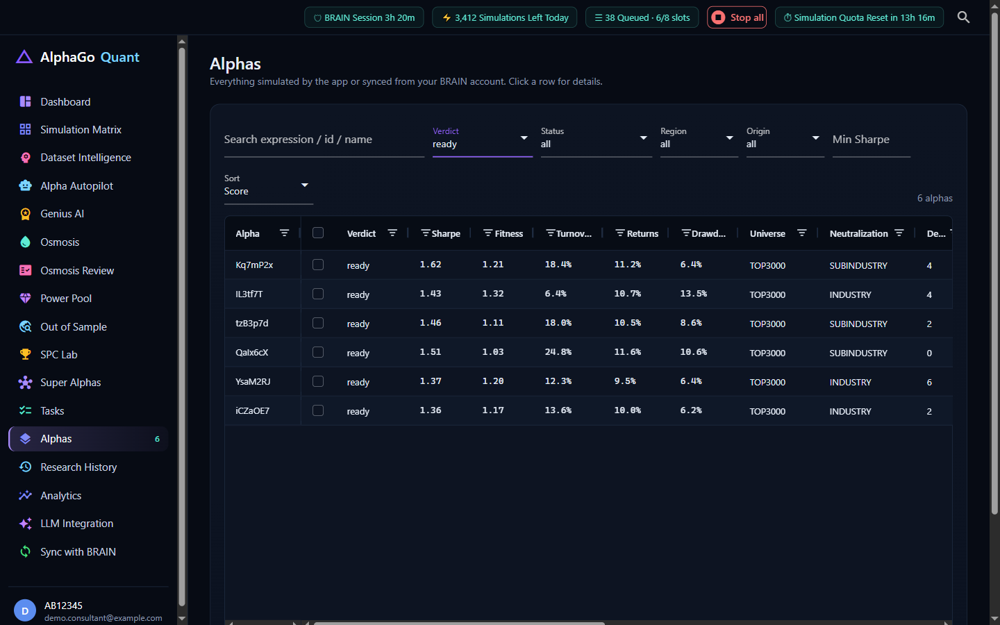

Double-click a row (or click its Alpha id) for the details window:

| Part | What it shows or does |
| --- | --- |
| Header | Alpha id, verdict, status, SUPER badge, classifications, ↗ to open it on the BRAIN website |
| Expression, settings, hypothesis | Exactly what was simulated, and the idea behind it |
| Metrics | Sharpe (green at or above BRAIN's limit), Fitness, Turnover, Returns, Drawdown, Margin (bps), Long / Short, Self corr, Ops / fields |
| Check badges | Every BRAIN check with value / limit; hover for BRAIN's message |
| **Check** | Runs BRAIN's full submission check, including self- and prod-correlation. Can take a minute or more |
| **Submit…** | Opens the submit confirmation. Greyed out for alphas already ACTIVE |
| **Optimise** | Queues up to 8 targeted variants plus up to 3 AI refinements. **Spends quota** |
| **PnL & yearly stats** | PnL chart and a table of yearly results from BRAIN |
| **Self-correlation** | Your highest correlation with your other alphas |
| **Properties** | Name, tags, colour and description. **Write with AI** drafts the description; **Save to BRAIN** stores them (the description for regular alphas only) |

**Verdicts** used across the app:

| Verdict | Meaning | What to do |
| --- | --- | --- |
| `ready` | BRAIN's full check passed, correlation included | Review and submit |
| `strong` | No in-sample test fails (pending tests and warnings allowed); the full check has not passed yet, or the robustness gate held it back | Run **Check** |
| `promising` | A test fails, but Sharpe is at least 70% and fitness at least 50% of their limits; or every test passes except self- or prod-correlation | **Optimise**, or change the idea |
| `weak` | Sharpe 50–70% of the limit, or higher with fitness under half its limit | Usually drop it |
| `rejected` | No result (no Sharpe returned), or a failing test with Sharpe under 50% of the limit | Drop it |
| `submitted` | ACTIVE or decommissioned on BRAIN | Nothing |

When BRAIN has not returned a Sharpe or fitness limit, AlphaGo uses a fallback for that limit: 1.25 Sharpe, 1.0 fitness. A strongly negative alpha (Sharpe at or below −70% of the limit, outside CHN) is flagged as a sign-flip candidate and graded on its absolute Sharpe and fitness, so it shows as promising or weak rather than rejected; Optimise tries the negated expression first.

### BRAIN program pages

#### Genius AI — your quarterly level

Shows your level and target, days left in the quarter, and three progress bars: **Signals this quarter**, **Pyramids lit** (3 or more submissions in a region × delay × category) and **Combined alpha performance**. Below them sit the tie-breakers (average operators and fields per alpha, distinct operators and fields, longest simulation streak).

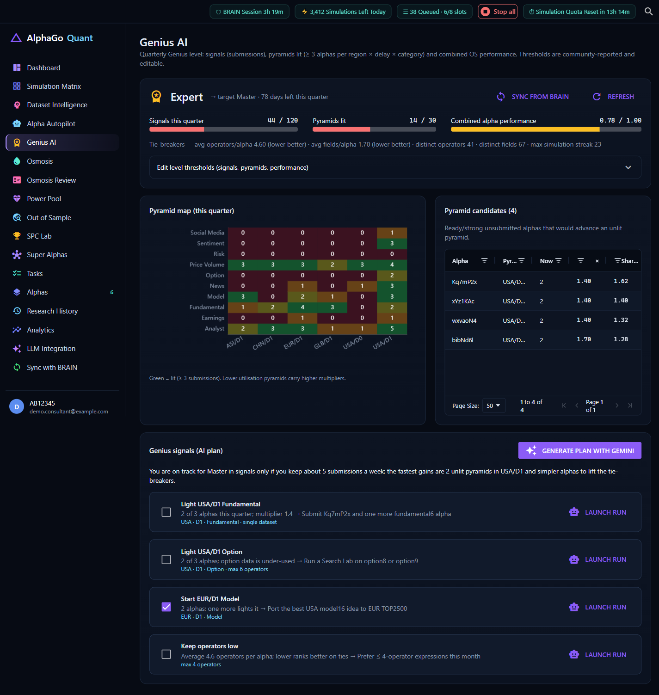

| Control | What it does |
| --- | --- |
| **Sync from BRAIN** / **Refresh** | Pulls the latest Genius summary and pyramids / redraws the page |
| **Edit level thresholds** | The community-reported thresholds (Expert 20 / 10 / 0.50, Master 120 / 30 / 1.00, Grandmaster 220 / 60 / 2.00 for signals / pyramids / performance). Correct them when BRAIN publishes new ones |
| **Pyramid map** | Region/delay × category heatmap with alpha counts; green = lit |
| **Pyramid candidates** | Ready or strong unsubmitted alphas that would advance an unlit pyramid. Double-click to open |
| **Generate plan with AI** | Turns your gaps into concrete goals. Tick a goal when done; **Launch run** opens the Autopilot set to that region and the "pyramid gaps first" dataset strategy |

#### Osmosis — weekly points

Spreads 100,000 points per region/delay scope over your submitted alphas, using each alpha's in-sample daily PnL.

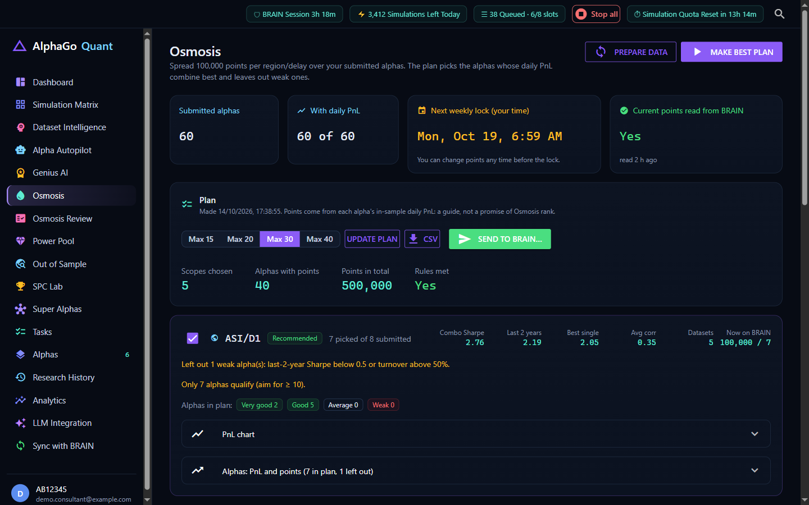

| Control | What it does |
| --- | --- |
| **Prepare data** | Background job: reads your submitted alphas, current points and daily PnL from BRAIN |
| **Make best plan** | For every scope: leaves out alphas with last-2-year Sharpe below 0.5 or turnover above 50%, rates the rest, and picks the alphas whose daily PnL combine best |
| Tiles | Submitted alphas, alphas with daily PnL, **Next weekly lock** in your local time, whether current points were read in the last 12 hours |
| Plan card | **Max 15 / 20 / 30 / 40** alphas per scope, **Update plan**, **CSV**, **Send to BRAIN…**, and totals (scopes, alphas, points, **Rules met**) |
| Scope cards | Tick to include. **Combo Sharpe**, last 2 years, best single alpha, average correlation, datasets, points now on BRAIN, rating badges, **PnL chart**, and **Alphas: PnL and points** where a points cell can be edited |
| **Lock time, limits and weighting** | Lock day and time (New York; default Sunday 23:59), 1,000–15,000 points per alpha, at least 10 alphas per scope, the leave-out rule, and the weighting method (Equal risk, Quality-weighted, Half-Kelly (Chan), Inverse correlation, Equal points; the page reopens on Equal risk) |

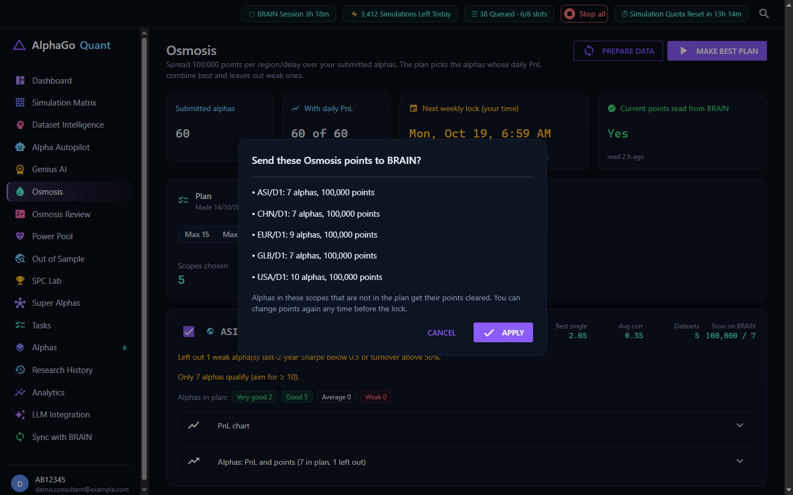

#### Osmosis Review — what the points on BRAIN look like now

**Refresh data** re-reads the points. Tiles count scopes and alphas with points and scopes with big or some mistakes (big: points on weak alphas or alphas without daily PnL, totals other than 100,000, fewer than 10 alphas, average correlation above 0.5, an alpha above 15,000 points; some: points on Average-rated alphas, a combo Sharpe more than 20% below the best plan). **Predict with AI** takes your current Osmosis score and returns a predicted range for the next one; **Explain my mistakes** lists each problem with a fix. Both send numbers only, never expressions, in **English** or **Hinglish**. A collapsed section shows combined Osmosis performance over time and the allocation history.

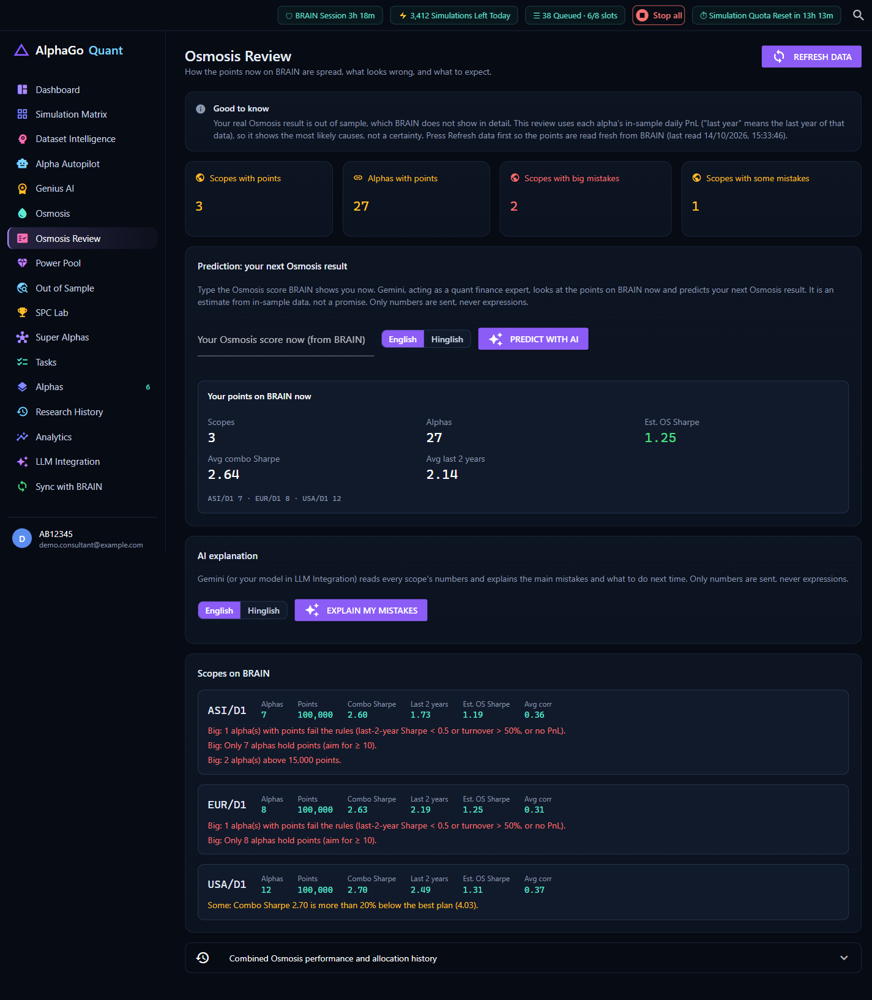

#### Power Pool — the monthly pick

Picks the best Power-Pool-shaped alphas (8 or fewer operators, 3 or fewer fields) you submitted in a month, per scope, then tags them `PowerPoolSelected` on BRAIN.

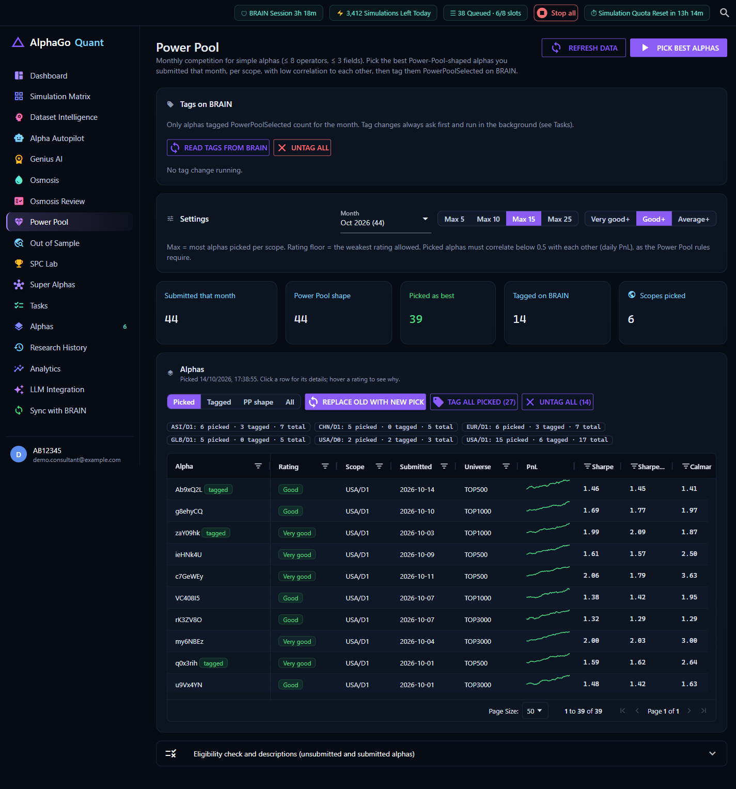

| Control | What it does |
| --- | --- |
| **Refresh data** / **Read tags from BRAIN** | Refresh data reads your submitted alphas (with their tags) and any missing daily PnL; Read tags from BRAIN re-reads only the chosen month's alphas |
| **Month**, **Max 5 / 10 / 15 / 25**, **Very good+ / Good+ / Average+** | Which month, how many per scope, the weakest rating allowed |
| **Pick best alphas** | Picks per scope, skipping any alpha whose daily PnL correlates 0.5 or more with one already picked |
| **Picked / Tagged / PP shape / All** | Table views with rating (hover for why), PnL sparkline, Sharpe, 2-year Sharpe, Calmar, turnover, last-year PnL, ops / fields, max correlation |
| **Replace old with new pick**, **Tag all picked**, **Untag all** | Each lists the tag changes and asks first, then runs as a background job |
| **Eligibility check and descriptions** (collapsed) | Scans alphas with Sharpe 0.8 or more (unsubmitted by default) against the rules, **Write descriptions (AI) for selected** (writes on click), **Power-pool correlation**, **Open Autopilot with Power Pool goal** |

#### Out of Sample — which submitted alphas may fade

Compares each submitted alpha's early in-sample years with its last 2 in-sample years. **Holds** is last-2-year Sharpe ÷ earlier Sharpe; together with the last-2-year Sharpe, turnover, complexity and length of history it gives a 0–100 **Risk**, an outlook (**Robust / Likely fine / Fading / Overfit risk**), an **Est. OS Sharpe** (a rule of thumb, not a BRAIN number) and the main reason. Sorted riskiest first, filterable by type and outlook. The collapsed section plots BRAIN's own OS Sharpe against IS Sharpe and fetches **Before/after pool performance** for a selected alpha.

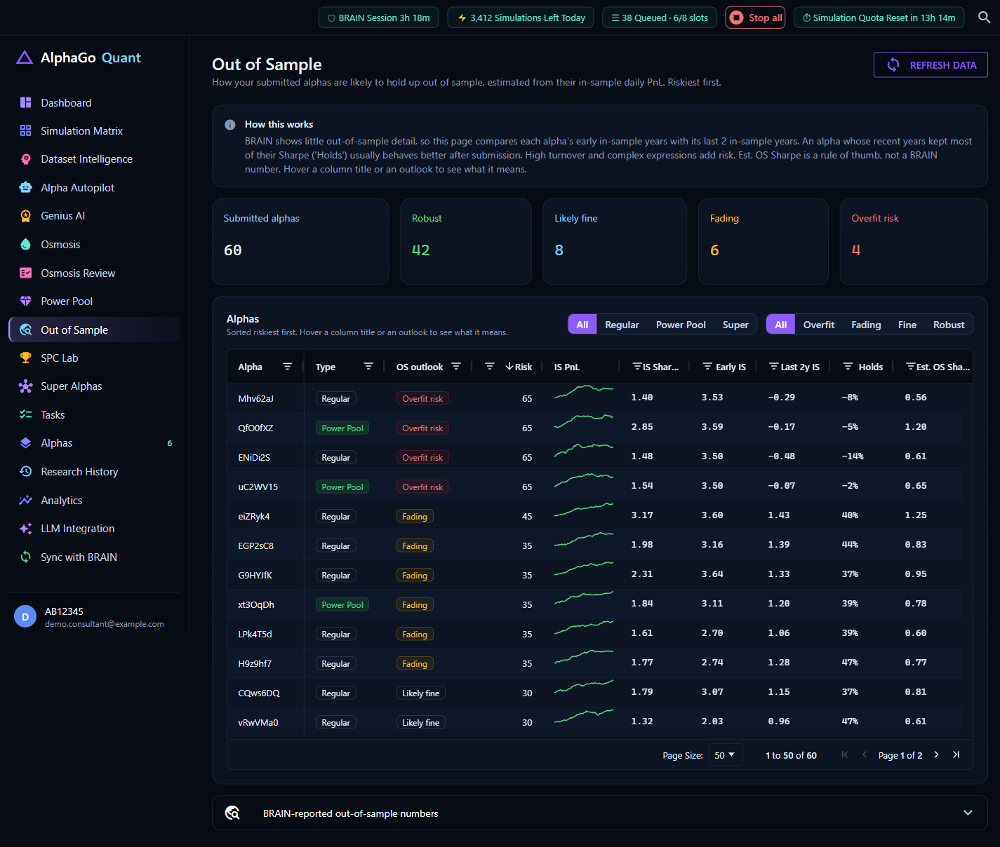

#### SPC Lab — Systematic Predictions Challenge prompts

Tests a prompt before you paste it into BRAIN's form. It never submits.

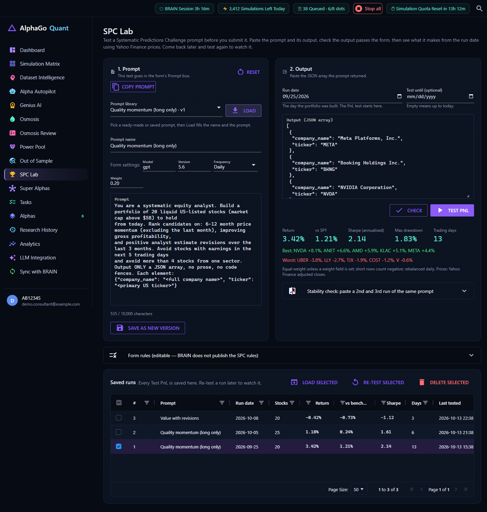

1. **Prompt:** load a ★ starter or saved prompt from **Prompt library**, set the form settings (Model, Version, Frequency, Weight), watch the 10,000-character counter, **Save as new version**, **Copy prompt**.
2. **Output:** paste the JSON array the prompt returned, set **Run date** and optionally **Test until**, then **Check** (form rules) and **Test PnL** (Yahoo Finance prices; return, return vs the benchmark (SPY by default), Sharpe, max drawdown, chart, best and worst names).
3. **Stability check:** paste a 2nd (and optionally a 3rd) run and click Compare runs to see stock overlap and return correlation.
4. **Form rules** (collapsed): required fields, row limits, weight and long/short fields, benchmark, character limit. BRAIN does not publish these; enter them when you have them.
5. **Saved runs:** every test is saved; **Re-test selected** later to watch it.

#### Super Alphas — combine your submitted alphas

Follows the Super Alpha guide in three numbered steps (step 1 in the left card, steps 2 and 3 in the right card): **1 · Choose components** (a region's ACTIVE alphas; **Rename selected to code** with confirmation, or **Tag selected with code** at once), **2 · Expressions & settings** (selection expression such as `name == '321'` with presets, combo `1` = equal weight, universe, delay, neutralization, decay, truncation, selection limit of at least 10, selection handling; **Preview selection**, **Simulate SuperAlpha**) and **3 · Describe & submit** (**Open details**, **Write descriptions (AI)**, **Submit…**). Super Alphas need turnover of 2–40%, two descriptions of 100+ characters, and have their own limit of 1 a day.

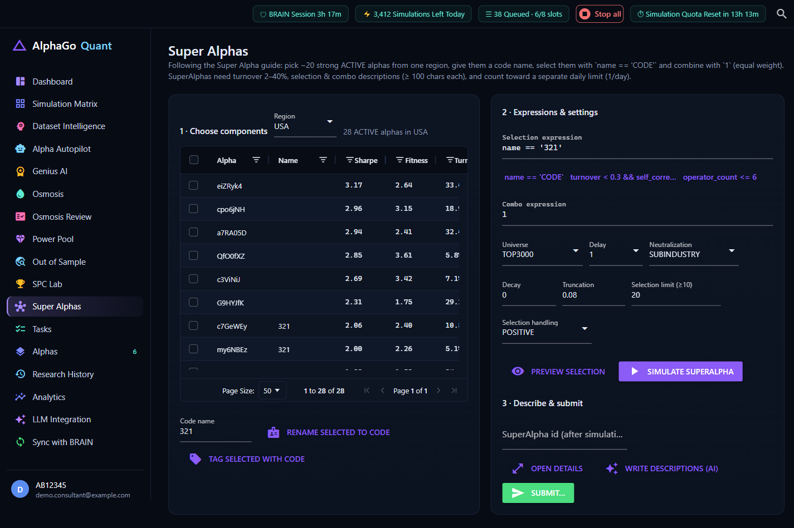

### Records and setup

| Page | What it holds |
| --- | --- |
| **Research History** | The last 50 Autopilot runs (batch counts, strong and ready totals), and the **Idea journal**: every simulated idea with hypothesis, verdict, metrics and failing checks. Search and filter by verdict; double-click to open the alpha. Rejected and weak shapes are fed back to the AI as "avoid" examples (up to 25 per region and dataset) |
| **Analytics** | Simulations per day (30 days), AI success rate, Sharpe distribution, most frequent failing checks, yield by generator and by dataset (top 20), LLM calls per day |
| **LLM Integration** | **Active provider** (Gemini, Claude, OpenAI / compatible, Ollama (local)), the provider's key or server URL (**Save & test**, **Test connection**, **Forget key**), for Ollama the **Context window**, model per role (Ideation, Refinement, Descriptions; **Auto** by default), thinking level, ideas per call, daily call budget (cloud providers), starting requests per minute, language of AI explanations, usage chart, and the Jinja2 **Prompt templates** editor with **Reset to default** and **View knowledge pack** |
| **Sync with BRAIN** | **BRAIN account** sign-in (with the biometric verification box), **Simulation settings available to you** (live from BRAIN; **Refresh from BRAIN**), **Data catalogue** syncs per scope, **Your alphas & programs** syncs, and the last 8 sync tasks |

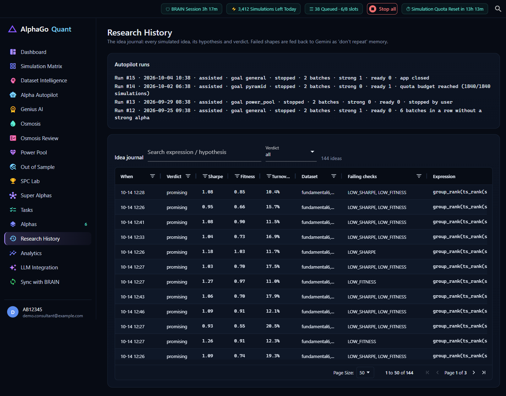

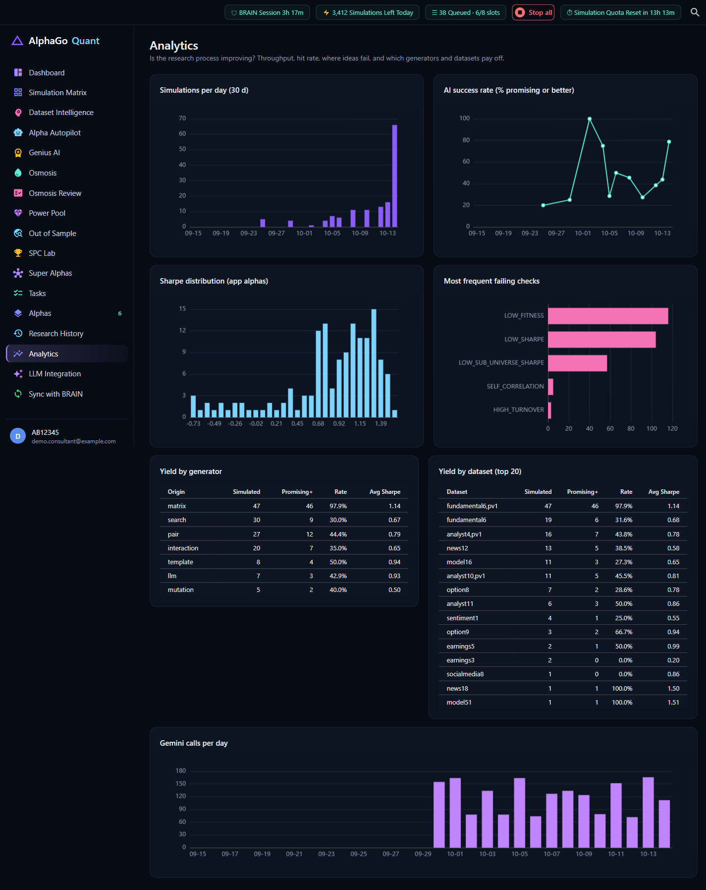

## 4. A typical day

A BRAIN day starts at the daily quota reset (midnight New York; unless BRAIN reports another time; the ⏱ chip counts down to it). A good AlphaGo day has six blocks: the overnight plan, a morning check, approvals, research, review and submit, and a wrap-up. The Autopilot prepares the first block for you; every block after that is yours.

### The day, block by block

| Block | Page | What you do | Quota spent |
| --- | --- | --- | --- |
| **1. At the reset** (no action) | — | If AlphaGo is open and signed in, the mode is Assisted or Full Autopilot and **Run research batches automatically** is on, then within about 5 minutes of the reset (or soon after you next open AlphaGo and sign in) it skips yesterday's unapproved proposals, resumes tasks that hit yesterday's cap, and proposes **Tasks per day** new tasks (default 2). Full Autopilot starts them within the **Daily Autopilot cap**. Whatever the setting, a queue that BRAIN paused for quota resumes by itself | Full Autopilot up to the cap, plus anything you had already queued |
| **2. Morning check** | Dashboard | Read **Simulations Left Today**, **Queued**, **Ready for Submission** and red lines in **Recent AI activity**. If the session chip is red or reads "⚠ BRAIN verification required", fix it on **Sync with BRAIN** first (an amber countdown under 30 minutes renews itself) | None |
| **3. Approve the plan** | Alpha Autopilot | Read each proposed task's reason. **Approve** the ones you agree with, **Skip** the rest | Each approved task, as it runs |
| **4. Research** | Dataset Intelligence, Simulation Matrix, Tasks | Pick one or two high-scoring datasets, ideally ones that light a new pyramid (Genius AI). Start a **Research task…** or simulate a handful of AI ideas. Test your own ideas in the Matrix (**Validate** first, it is free). Watch progress and best Sharpe on **Tasks** | What you start |
| **5. Review and submit** | Alphas → details window | Filter **Verdict = strong**, tick the best, **Run submission check on selected**. Open each `ready` alpha: PnL, self-correlation, description, then **Submit…** → **Submit to BRAIN**. Up to 4 regular submissions a day (AlphaGo counts only submissions made from AlphaGo) | Optimise only |
| **6. Wrap up** | Research History, Analytics, Tasks | See which ideas failed and why, which datasets and generators pay off, and leave tasks running or press **Stop all** | None |

AlphaGo works only while it is open. If you close it, running tasks pause until you resume them, other queued simulations continue after you next sign in, and interrupted jobs must be retried (section 2).

### An example day

The screenshots in section 5 follow this day on USA · D1 · TOP3000.

1. After the reset (AlphaGo was left open and signed in), the Autopilot (Assisted) proposed task #41: **Search Lab** on `fundamental6`, 500 simulations on 4 cores, because the Fundamental theme has the fewest strong alphas.
2. On the Dashboard you see 3,412 of 5,000 simulations left, 38 already queued and 6 alphas ready to submit.
3. On Alpha Autopilot you approve #41. On Dataset Intelligence `fundamental6` is the top pick (AI score 84, best for Single), so you also try the template `group_rank(ts_rank({field}/cap, {window}), {group})` in the Simulation Matrix.
4. By midday, task #40 (yesterday's Search Lab on the same dataset) has found alpha `Kq7mP2x`: Sharpe 1.62, fitness 1.21, turnover 18.4%.
5. You run **Check**: every test passes, self-correlation 0.41. You let **Write with AI** draft the description, save it, and submit `Kq7mP2x`. It is your second regular submission today (2 of 4).
6. Before you stop, Research History shows which ideas failed and why; rejected and weak shapes go to the AI as "avoid" examples from now on.

### The longer rhythm

| When | Page | What you do |
| --- | --- | --- |
| Every week, before the Osmosis lock (default Sunday 23:59 New York; the tile shows your local time) | Osmosis | **Prepare data**, **Make best plan**, check each scope, **Send to BRAIN…** → **Apply** |
| After the lock | Osmosis Review | **Refresh data**, read the mistakes, **Explain my mistakes** |
| Every month, once the month's submissions are in | Power Pool | **Refresh data**, **Pick best alphas**, **Replace old with new pick → Apply** |
| Every week or so during the quarter | Genius AI | **Sync from BRAIN**, check pyramids and signals, **Generate plan with AI**, **Launch run** on a gap (it opens Alpha Autopilot set up for that gap; start research there) |
| After syncs | Out of Sample | Look for **Fading** and **Overfit risk** alphas before you weight them in Osmosis |
| When you have about 20 strong submitted alphas in one region | Super Alphas | Rename, preview, simulate, describe, submit (1 a day) |
| Whenever you work on the SPC challenge | SPC Lab | Test and re-test prompts; paste the winner into BRAIN's form yourself |

**Tip from the README:** practitioner data (about 830 simulations per live alpha) shows that correlation, not generation, is the bottleneck. A new dataset or a new economic mechanism breaks correlation; changing windows or neutralization rarely does. That is why the Autopilot favours new datasets and themes and caps how many variants of one expression skeleton it tries.

## 5. Step by step: from first launch to a submitted alpha

Twelve steps take you from a fresh install to a submitted alpha. Steps 1–4 are one-time setup: about 10 minutes and a single simulation. Steps 5–12 are the research loop you repeat every day. The example follows USA · D1 · TOP3000, the dataset `fundamental6` and the alpha `Kq7mP2x`.

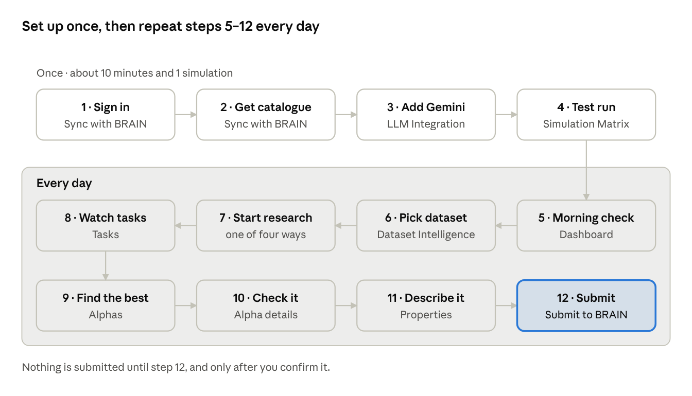

Steps 1–4 run once; steps 5–12 make up each research day, and only step 12 sends an alpha for submission.

### Part A — one-time setup

#### Step 1. Sign in to BRAIN (Sync with BRAIN)

1. Click **Sync with BRAIN** at the bottom of the sidebar.
2. In the **BRAIN account** card, type your BRAIN **Email** and **Password**.
3. Leave **Save credentials in Windows Credential Manager** ticked. AlphaGo then signs you in at every start and renews the session before it expires.
4. Click **Sign in**. The card turns to a green **● Signed in as AB12345**, with the session time and your permissions underneath.

**If a yellow "Biometric verification required" box appears:** click **Open verification page**, finish the check in your browser, come back and click **Continue**. AlphaGo waits up to 3 minutes for BRAIN to confirm.

**Check the result:** click **Refresh from BRAIN** (or reopen the page). The **Simulation settings available to you** card then reads "Live from OPTIONS /simulations" and lists every region with its delays and universes. The region, delay and universe pickers across the app use this list.

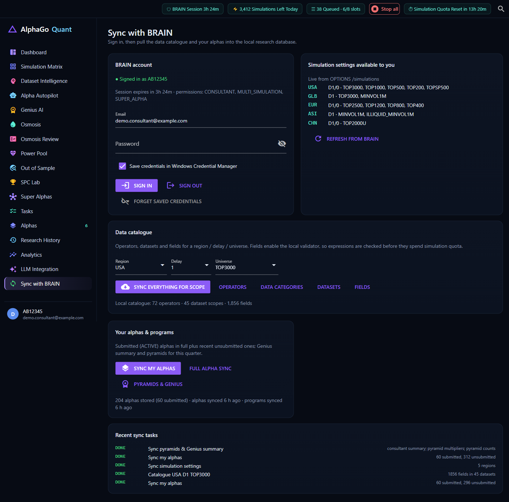

#### Step 2. Download the catalogue and your alphas (same page)

1. In **Data catalogue**, choose **Region** `USA`, **Delay** `1`, **Universe** `TOP3000`.
2. Click **Sync everything for scope**. A job called "Catalogue USA D1 TOP3000" downloads operators, datasets and fields (data categories have their own Data categories button).
   - Fields still take a few minutes. AlphaGo fetches up to 4 pages at a time (`brain.catalog_concurrency` in settings.json; set it to 1 if BRAIN throttles you). Progress shows under **Recent sync tasks** and on **Tasks**.
   - The line under the buttons counts up as it runs: "Local catalogue: … operators · … dataset scopes · … fields".
3. In **Your alphas & programs**, click **Sync my alphas** (all submitted alphas plus recent unsubmitted ones), then **Pyramids & Genius**. **Full alpha sync** fetches everything if you need it.
   - BRAIN lists at most 1,000 alphas per request. AlphaGo reads larger accounts in windows of creation dates, so every alpha is fetched exactly once.
4. Repeat 1–2 for every region you research.

The catalogue is what lets AlphaGo reject an unknown field or a wrong operator **before** it costs a simulation.

#### Step 3. Connect an AI model (LLM Integration)

1. Open **LLM Integration** and choose the **Active provider**. Every AI feature uses that one provider; Gemini is the default.
2. Give AlphaGo what that provider needs, then click **Save & test**:

   | Provider | What to enter |
   | --- | --- |
   | **Gemini (Google AI Studio)** | A key from https://aistudio.google.com/apikey in **Gemini API key** |
   | **Claude (Anthropic)** | A key from https://console.anthropic.com in **Anthropic API key** |
   | **OpenAI / compatible** | An OpenAI key. For OpenRouter, Groq, DeepSeek, LM Studio, vLLM or any other server with the OpenAI chat API, change **Server URL** too; local servers usually need no key |
   | **Ollama (local)** | Install Ollama from https://ollama.com and download a model with `ollama pull <model>`. Keep the server URL `http://localhost:11434` |

3. **status: ok** turns green, and the three model selectors list the provider's models: **Ideation (bulk ideas)**, **Refinement (near misses)** and **Descriptions**.
   - Gemini, Claude and Ollama: you can leave them on **Auto**. Claude's Auto is Claude Opus 5.5 for every role; Sonnet 5.5 or Haiku 5.5 cost less. Ollama's Auto is the first installed model.
   - OpenAI / compatible: choose a model for each role, then click **Test connection** again. You can also type a model name the server does not list.
4. Optional: lower **Daily call budget** (default 400, cloud providers only) or change **Thinking level** (default low).

Cloud providers start at 6 requests a minute, and AlphaGo slows down by itself whenever the provider answers 429 (rate-limited). An Ollama model runs on your PC, one request at a time, with no rate limit and no budget.

**Before you rely on a local model:**

- **Context window** (default 32,768 tokens) must hold the knowledge pack plus a dataset's fields, often 15–20k tokens. AlphaGo warns you when a prompt is cut.
- Each reply is capped at 8,192 tokens (`llm.ollama.num_predict`), so a model stuck in a loop stops with a clear error instead of running for many minutes.
- Speed and quality depend on your hardware and the model. In a test on a PC with no graphics card, the 270-million-parameter `gemma3:270m` took about 4 minutes for one ideation call, and none of its expressions passed the validator. Use a larger model, ideally on a GPU. The validator rejects invalid expressions before they cost any simulations.

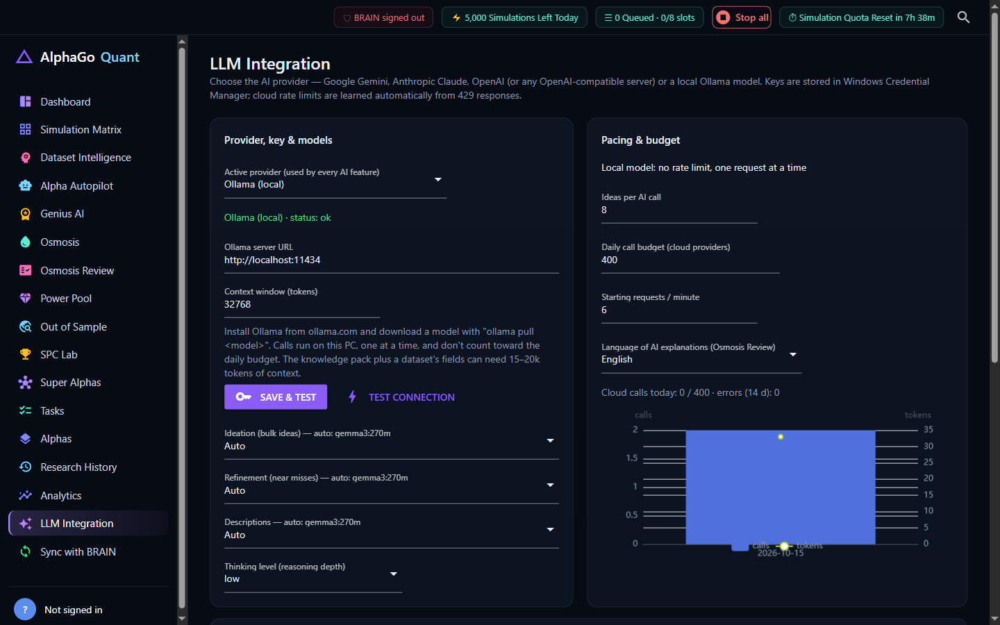

#### Step 4. Run one test simulation (Simulation Matrix)

This proves the whole chain works on your account for one simulation.

1. Open **Simulation Matrix**. In the **Expressions** tab, delete both example lines and type `rank(-ts_delta(close, 5))`.
2. In **Settings matrix**, keep one universe (`TOP3000`). In **Neutralizations**, remove the `INDUSTRY` chip so only `SUBINDUSTRY` stays. Change **Decays** from `0, 4` to `0`.
3. The blue line must start with **1 expression(s) × 1 setting combination(s) = 1 simulations**.
4. Click **Validate**: "✓ All 1 expressions passed local validation".
5. Click **Run matrix**: "Queued 1 simulations (0 reused from cache)". The run is selected in **Matrix batch**; within a minute or two its row shows `done` with Sharpe, fitness and turnover.
6. Double-click the row to open the alpha. Setup is done.

### Part B — the daily research loop

#### Step 5. Morning check (Dashboard)

1. Open **Dashboard**. The welcome line tells you how many simulations are left and, if any, how many are already queued.
2. Read the four tiles: **Submittable Alphas**, **Simulations Left Today**, **Sent Today**, **Queued**.
3. Scan **Recent AI activity** for red lines (errors) and amber ones (warnings).
4. Check the header: a teal **BRAIN Session** chip means you are signed in. Amber or red: go back to step 1.


#### Step 6. Choose a dataset (Dataset Intelligence)

1. Open **Dataset Intelligence** and set **Region / Delay / Universe** (top right) to `USA / 1 / TOP3000`.
2. Only the first time for a scope: click **Rate datasets with AI**. The job "AI-rate datasets USA D1 TOP3000" runs on **Tasks**; when it is done, open the page again to see the ratings.
3. Read **Top recommendations**. In the example `fundamental6` leads with an AI score of 84, theme Fundamental, best for **Single Field** alphas.
4. Narrow the table with **Single**, a theme chip or the search box. **Tested** shows how many of your own simulations each dataset has had; **Pyramid ×** shows its pyramid multiplier.
5. Click `fundamental6`. Its panel opens below the table. Click **Analyze with AI** for a brief: themes, pitfalls, key fields and idea families with ready-made templates.

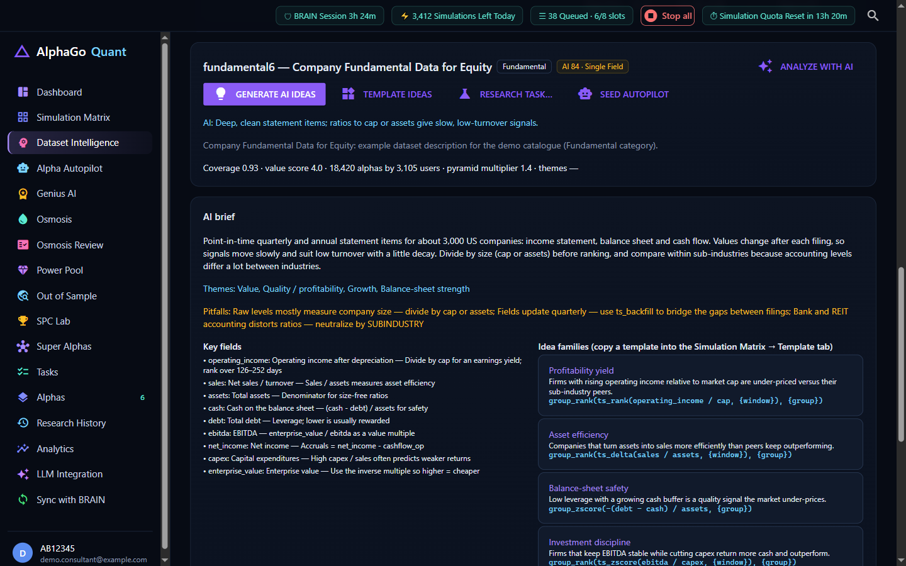

**Tip:** prefer datasets that would light a new pyramid (see **Genius AI → Pyramid candidates**) or a theme where you have few strong alphas. New data breaks correlation; new windows rarely do.

#### Step 7. Start research — pick one of four ways

**A. A research task (best for a systematic search)**

1. In the `fundamental6` panel, click **Research task…**. The **New research task** dialog opens, pre-filled from the AI recommendation: **Kind** Search Lab, `USA / 1 / TOP3000`, **Dataset** `fundamental6`.
2. Set **Simulations** (example: 500) and **Cores (of 8)** (example: 4). Leave **Start now** ticked.
3. Click **Create**. "Task #… started." It spends about 500 simulations, plus a few dozen for optimisation and robustness tests. It works in waves of generate → check locally → skip shapes this market has already answered → simulate; then it optimises the best near misses and runs BRAIN's check and the robustness test on its best strong alphas.

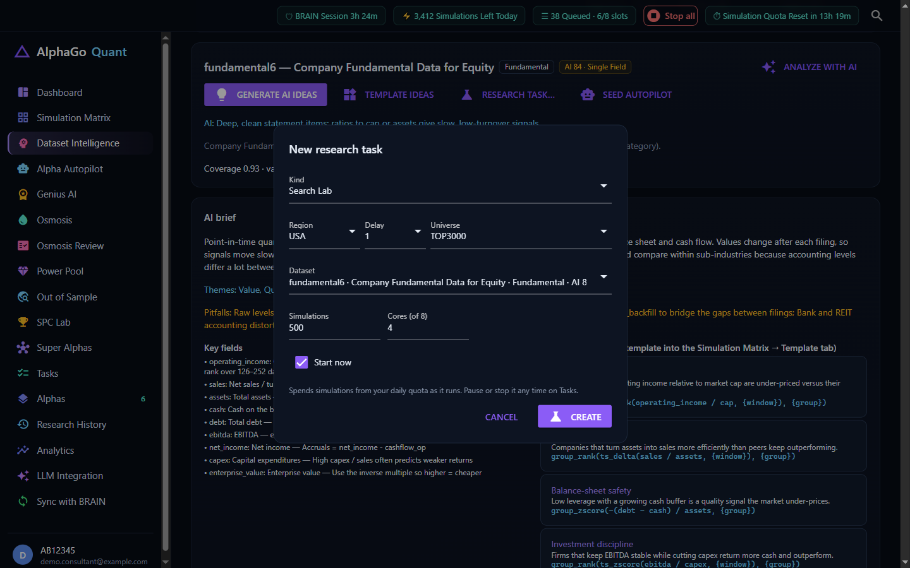

**B. Approve the Autopilot's proposal (Assisted mode)**

1. Open **Alpha Autopilot**. Under **Proposed tasks waiting for your approval** you see, for example, "#41 · Search Lab · fundamental6 · USA D1 TOP3000 · 500 simulations · 4 cores" with its reason.
2. Click **Approve** to start it, or **Skip**.


**C. A handful of AI ideas**

1. In the dataset panel, click **Generate AI ideas** (or **Template ideas** for 12 without AI).
2. A dialog lists each expression with its hypothesis, all ticked. Untick what you don't want.
3. Click **Simulate selected**. One simulation per ticked idea not simulated before.

**D. Your own template (Simulation Matrix)**

1. Open the **Template** tab and write the pattern. The example uses `group_rank(ts_rank({field}/cap, {window}), {group})`: each field divided by market cap, ranked over time, then ranked within its group.
2. Type a word in **Search fields** (for example `operating`), press Enter and pick fields in **Fields**; the example picks `operating_income` and `sales`. Set **Windows** to `66, 126, 252` and **Groups** to `subindustry, industry`.
3. In **Settings matrix**, choose **Neutralizations** (here SUBINDUSTRY and INDUSTRY) and **Decays** (`0, 4`). The blue line shows the cost: "12 expression(s) × 4 setting combination(s) = 48 simulations". Click **Validate**, then **Run matrix**.
4. When results arrive, set **Heatmap X** to `neutralization`, **Heatmap Y** to `decay` and **Metric** to `sharpe`. In the example every cell sits between 1.04 and 1.25 mean Sharpe, best at SUBINDUSTRY with decay 4: a plateau, not a single bright cell. Double-click the best rows to see their checks.

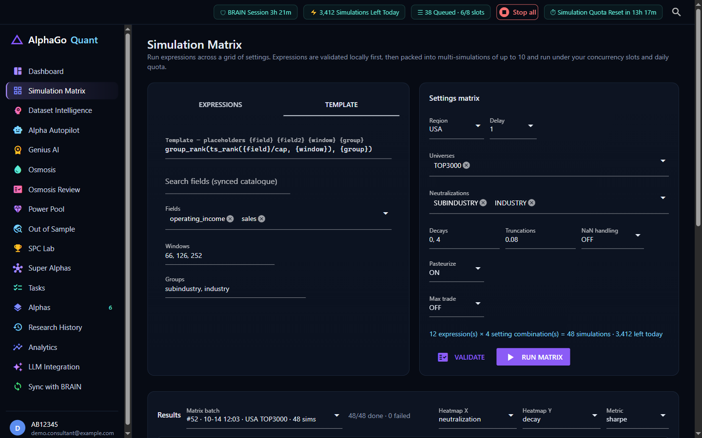


#### Step 8. Follow the research (Tasks)

1. Open **Tasks**. The **Research tasks** table shows each task's status, cores, a progress bar (done / planned) and the **Best** Sharpe so far. In the example task #40 is running at 312 / 500 with a best Sharpe of 1.62.
2. Hover a status to read its message. **Alpha Autopilot** shows the newest active task with its stage bar and, if anything was skipped, **Left out on purpose**.
3. Double-click a task to list its alphas, best first. Double-click an alpha there to open it.
4. Need quota elsewhere? Tick the task and click **Pause**; **Resume** later. **Stop** ends it and removes its queued simulations.
5. If a job in the **Jobs** table failed, read the message, fix the cause and click **Retry selected**.


#### Step 9. Find the best candidates (Alphas)

1. Open **Alphas**. Set **Verdict** to `strong` and **Status** to `UNSUBMITTED`; keep **Sort** on **Score**.
2. Tick the most promising rows and click **Run submission check on selected**. A "Check … alphas" job runs BRAIN's full check, correlation included.
3. Alphas that pass become `ready`, and the number beside **Alphas** in the sidebar goes up. Set **Verdict** to `ready`.


#### Step 10. Inspect and check the alpha (alpha details)

1. Double-click `Kq7mP2x`. The details window opens.
2. Read the expression, the settings line and the hypothesis: "Firms with rising operating income relative to market cap are under-priced versus their sub-industry peers."
3. Read the metrics. Sharpe 1.62 is green because it clears BRAIN's 1.25 limit; fitness 1.21, turnover 18.4%.
4. Read the check badges. Every test must say PASS (MATCHES\_PYRAMID, MATCHES\_THEMES and MATCHES\_COMPETITION are only informational), for example "LOW\_SHARPE · PASS 1.620 / 1.250" and "SELF\_CORRELATION · PASS 0.410 / 0.700". Hover a badge for BRAIN's message.
5. If the verdict is still `strong`, click **Check** and wait; the window reopens with fresh badges.
6. Click **PnL & yearly stats**. Look for a steady PnL line and no single year carrying the result.
7. Click **Self-correlation**: "Self-correlation max 0.410 across … of your alphas."
8. A `promising` alpha instead? Click **Optimise** to queue up to 11 variants (8 rule-based, up to 3 from the AI), then come back to step 9.

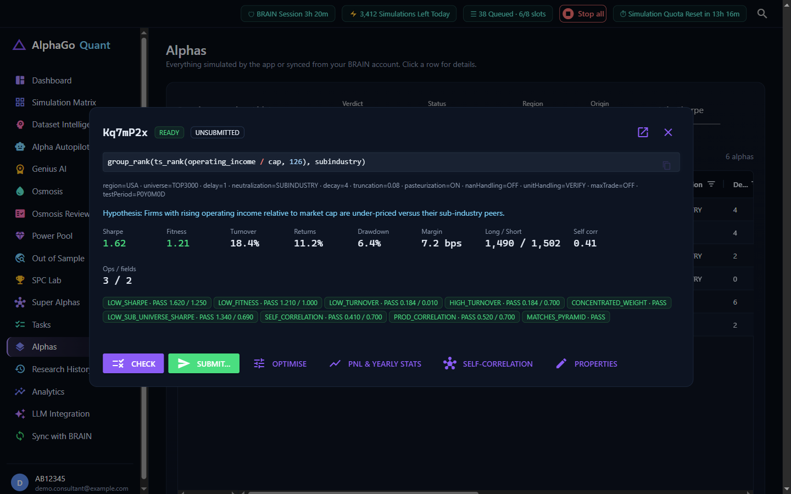

#### Step 11. Describe the alpha (Properties)

1. In the details window, click **Properties**.
2. Optionally set **Name**, **Tags** and **Color**.
3. Click **Write with AI**. The description fills in the Idea / Rationale for data / Rationale for operators format; the counter shows its length (Power Pool needs 100 characters or more).
4. Edit it if you like, then click **Save to BRAIN**. This writes to your BRAIN account at once.

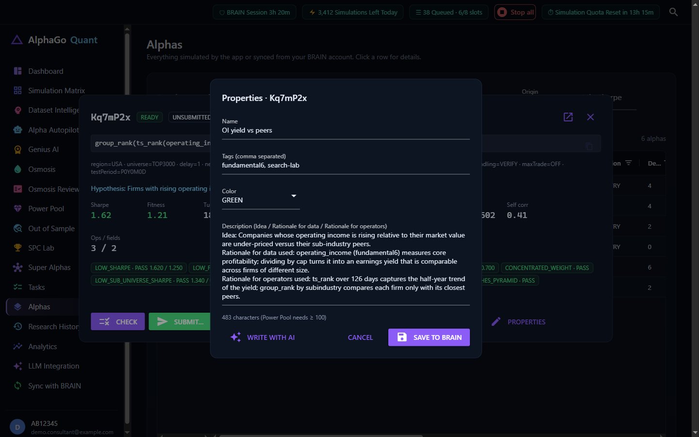

#### Step 12. Submit

1. In the details window, click **Submit…**.
2. The confirmation "Submit Kq7mP2x to WorldQuant BRAIN?" shows the expression, settings, metrics, every check badge and today's count, for example "Today's regular submissions: 1/4. Submission is final and visible to WorldQuant." The count covers submissions made from AlphaGo since midnight New York.
   - If BRAIN's check has not passed, an amber warning tells you to run **Check** first; BRAIN would reject the submission.
   - At the daily limit, **Submit to BRAIN** is greyed out.
3. Read it once more. Click **Submit to BRAIN**, or **Cancel**.
4. "Submitting Kq7mP2x — follow progress in Tasks." A **Submit Kq7mP2x** job runs in the **Jobs** table.
5. On success, **Recent AI activity** shows "Kq7mP2x submitted (active)." (or "submitted (accepted)" while BRAIN is still processing). The alpha's status turns ACTIVE and its verdict `submitted`; reopen it and **Submit…** is greyed out.
6. If BRAIN refuses, the feed shows "Kq7mP2x not submitted: …" with BRAIN's reason, and the job finishes with "rejected: …". Read the reason before you retry: **Retry selected** on a Submit job sends it again without another confirmation.

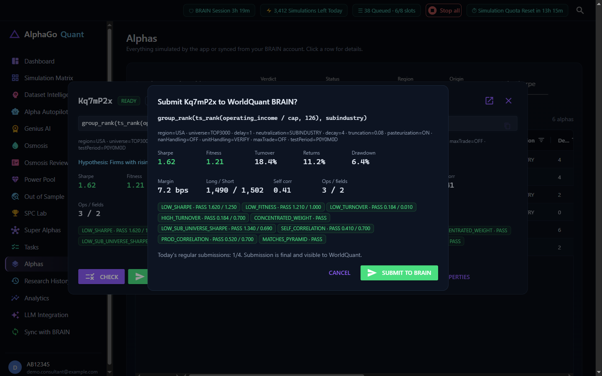

After a submission, the alpha counts toward your Genius signals and pyramids, and it becomes a candidate for next week's Osmosis plan and, if it has the Power Pool shape, this month's Power Pool pick.

## 6. Safety, settings and troubleshooting

AlphaGo spends quota only when you, an approved task, or Full Autopilot within its cap asks it to, and it changes your BRAIN account only through the buttons listed below.

### Built-in safety controls

| Control | How it protects you |
| --- | --- |
| Submit confirmation | The only way to start a submission. It shows every check and today's count of submissions made from AlphaGo; **Submit to BRAIN** is greyed out at the daily limit, and AlphaGo refuses a submission past it |
| Assisted mode (default) | Proposed tasks and AI batches wait for your approval before any simulation is spent |
| Full Autopilot warning | The first time, you must tick **I have checked BRAIN's current rules and accept the risk for my account.** and click **Enable Full Autopilot**; the choice is then remembered. Full Autopilot checks the **Daily Autopilot cap** (500) before each wave or batch, so follow-up optimisation and robustness runs can take it slightly over. Your own tasks and approved Assisted proposals are not capped |
| **Stop all** (header) | Stops AI idea batches (their queued simulations are cancelled) and pauses every task and the queue at once. Nothing else is deleted. Daily planning stays on until you press **STOP AUTOPILOT** |
| Quota reserve | The simulation queue never spends the last 200 simulations of the day. A task the Autopilot plans is skipped if its planned simulations would break the reserve. **Simulate SuperAlpha** is the exception: it calls BRAIN directly |
| API only | No website scraping. AlphaGo honours `Retry-After`, lowers its slot limit when BRAIN rejects for concurrency, and adds one slot back each minute without rejections |
| Credentials | Only in Windows Credential Manager. AlphaGo never writes them to its log or database |

**Three things act without a fresh confirmation:** **Retry selected** on a Submit, Osmosis or Power Pool tag job repeats it as it was confirmed; **Continue** after biometric verification resumes the simulation queue, even after **Stop all**; and simulations queued before a restart are sent again once you sign in.

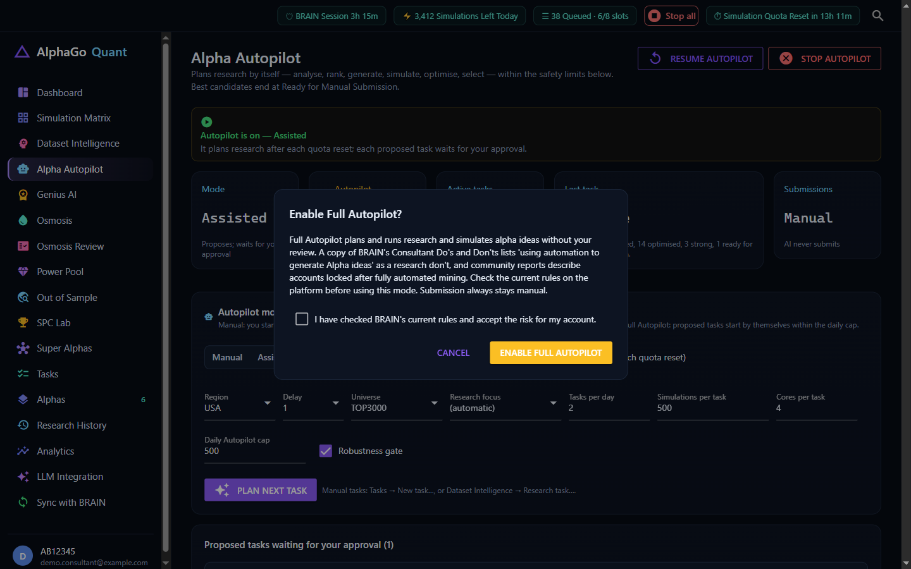

BRAIN's *Consultant Do's and Don'ts* lists "using automation to generate Alpha ideas" as a research don't, and there is a community report of a fully automated account being locked. Read the current rules on the platform; which mode you run is your decision.

### Buttons that spend simulations

| Page | Button | Simulations |
| --- | --- | --- |
| Simulation Matrix | **Run matrix** | At most the number in the blue preview line (invalid, duplicate and already-simulated ones are not sent) |
| Dataset Intelligence | **Simulate selected** (ideas dialog) | One per ticked idea not simulated before |
| Dataset Intelligence | Double-click a field | 4 |
| Dataset Intelligence, Tasks | **Research task…** or **New task…** → **Create** with **Start now** | The task's planned simulations as it runs, plus a few dozen for optimisation and robustness tests |
| Alpha Autopilot, Tasks | **Approve** (proposed task), **Resume**, **Run All** | The same, for each task started or resumed |
| Alpha Autopilot | **Approve selected & simulate** (AI batch), or **Start** in Full Autopilot | One per idea, then the batch's optimisation rounds and robustness tests |
| Alpha Autopilot, Dashboard | **Plan next task**, **Resume Autopilot** or **Run now** in Full Autopilot | The planned tasks start at once, within the cap |
| Tasks, Sync with BRAIN | **Resume queue**, **Continue** (after verification) | Whatever was already queued |
| Alpha details | **Optimise** | Up to 11 |
| Super Alphas | **Simulate SuperAlpha** | 1, sent directly (not held back by the reserve or **Stop all**) |

### Buttons that change your BRAIN account

| Page | Button | Asks first? |
| --- | --- | --- |
| Alpha details, Super Alphas | **Submit…** → **Submit to BRAIN** | Yes, with every check shown |
| Osmosis | **Send to BRAIN…** → **Apply** | Yes, a summary per scope. Alphas in those scopes that hold points but are left out of the plan get their points cleared |
| Power Pool | **Replace old with new pick**, **Tag all picked**, **Untag all** → **Apply** | Yes, with the counts and the first 12 alpha ids |
| Super Alphas | **Rename selected to code** → **Rename** | Yes |
| Alpha details | **Properties** → **Save to BRAIN** | You review the fields in the dialog first |
| Tasks | **Retry selected** on a Submit, Osmosis or Power Pool tag job | No, repeats that job as it was confirmed |
| Super Alphas | **Tag selected with code** | No, acts on click |
| Power Pool (eligibility section) | **Write descriptions (AI) for selected** | No, writes on click (up to 25) and overwrites existing descriptions; without an AI provider it writes a template description |
| Super Alphas | **Write descriptions (AI)** | No, saves to BRAIN, then shows you the text |

**What leaves your PC:** BRAIN API calls; prompts to the AI provider you chose, unless it is a local Ollama model (the knowledge pack of rules, your operators and templates; dataset and field descriptions; for idea generation, your best and rejected alpha expressions with their metrics; for refinement or descriptions, the alpha's expression and metrics; for the research and Genius plans, account statistics; Osmosis Review sends numbers only); and for SPC **Test PnL**, ticker symbols, the benchmark ticker and dates to Yahoo Finance.

### Settings you may want to change

| Where | Setting | Default |
| --- | --- | --- |
| LLM Integration | Active provider | Gemini |
| LLM Integration | Ideas per AI call (smaller calls give more varied ideas) | 8 |
| LLM Integration | Daily call budget (cloud providers; Ollama is not counted) | 400 |
| LLM Integration | Ollama context window | 32,768 tokens |
| LLM Integration | Starting requests per minute (then adapts on its own) | 6 |
| LLM Integration | Thinking level | low |
| LLM Integration | Language of AI explanations | English |
| Alpha Autopilot | Mode · research focus · tasks per day · simulations per task · cores per task · daily cap · robustness gate | Assisted · automatic · 2 · 500 · 4 · 500 · on |
| Osmosis | Lock day and time · points per alpha · alphas per scope · leave-out rule · weighting | Sun 23:59 New York · 1,000–15,000 · at least 10 · 2-year Sharpe < 0.5 or turnover > 50% · Equal risk |
| Power Pool | Max per scope · rating floor | 15 · Good+ |
| SPC Lab | Form rules | `company_name` and `ticker` required |
| Genius AI | Level thresholds | Community-reported values |

Advanced settings live in `%APPDATA%\AlphaGo\settings.json`, created the first time you change a setting. Close AlphaGo before you edit it.

| Key | Meaning | Default |
| --- | --- | --- |
| `brain.quota_reserve` | Simulations the queue always keeps back each day | 200 |
| `brain.max_slots` | Concurrent multi-simulations | 8 |
| `brain.multi_size` | Alphas per multi-simulation (2–10) | 10 |
| `brain.max_poll_minutes` | Give up polling one simulation after this long | 45 |
| `brain.catalog_concurrency` | Data-field requests in flight during a catalogue sync (1 = one at a time) | 4 |
| `llm.ollama.num_predict` | Most tokens one Ollama reply may use | 8,192 |
| `llm.ollama.timeout_s` | Seconds to wait for one Ollama reply (0 = 600) | 0 |
| `programs.daily_regular_submissions` | Regular submissions per day (counted from AlphaGo only) | 4 |
| `programs.daily_super_submissions` | Super Alpha submissions per day | 1 |
| `programs.pp_max_corr` | Power Pool: picked alphas must correlate below this | 0.5 |

### When something goes wrong

| What you see | What to do |
| --- | --- |
| Red **BRAIN signed out** chip, or "Sign in to BRAIN first" | Sign in on **Sync with BRAIN** |
| Amber **⚠ BRAIN verification required**, or the queue shows **PAUSED (BRAIN biometric verification required)** | On **Sync with BRAIN**, click **Open verification page**, finish it in the browser, then **Continue**. The queue resumes by itself |
| "Daily simulation quota reserve reached" | About 200 simulations (plus the next pack of up to 10) are left. Queued work waits for the next reset; AI batches stop |
| Queue **PAUSED (quota: …)** | BRAIN's daily limit is used up. While AlphaGo is open, the queue resumes by itself after the reset; or click **Resume queue** on **Tasks** |
| A proposed task shows **skipped** — "Not enough simulations left today." | Its planned simulations would break the reserve. Plan a smaller task or wait for the reset |
| Dropdowns show few or wrong universes | **Refresh from BRAIN** on **Sync with BRAIN** |
| Validate says "unknown identifier '…' (not a data field in the catalog)" or "fields not synced: identifiers checked loosely" | **Sync everything for scope** for that region, delay and universe |
| "No datasets with fields" when a task is planned, or "No fields synced for …" when it starts | Same: sync the catalogue for that scope |
| The AI provider is rate-limited (429) or the budget is reached | Wait; pacing recovers by itself. Or raise **Daily call budget**, use a paid tier, or switch to a local Ollama model (not budgeted) |
| "Ollama is not reachable at http://localhost:11434" | Start Ollama, or correct **Ollama server URL** on **LLM Integration** |
| "No … model chosen" | On **LLM Integration**, pick a model for each role (OpenAI / compatible has no Auto when the server lists several models) |
| Ollama warns that a prompt was cut, or "hit the 8,192-token reply limit" | Raise **Context window**, or use a larger model |
| "Ollama did not answer within 600 s" | The model is too slow on this PC. Use a smaller or GPU-backed model, or raise `llm.ollama.timeout_s` |
| "Claude declined this request" | Claude's safety check refused it. Try again, or switch provider for that task |
| A job on **Tasks** failed | Read its message, fix the cause (usually sign-in), then **Retry selected**. A retried Submit, Osmosis or tag job runs without asking again |
| A task says "Interrupted by an app restart — press Run to continue." | Tick it on **Tasks** and click **Resume** (or **Run All**) |
| **Submit to BRAIN** is greyed out | Today's limit of submissions made from AlphaGo is reached (for example 4/4) |
| **Submit…** is greyed out on Alpha details | The alpha is already ACTIVE |
| SPC **Test PnL** says Yahoo returned no prices | Check the tickers and dates; Yahoo sometimes throttles, so try later |
| The window does not open | Use browser mode (section 2) |
| Anything else | Read `%APPDATA%\AlphaGo\logs\alphago.log` |

### Frequently asked questions

**Does AlphaGo ever submit by itself?** No, in no mode, including Full Autopilot. Every submission starts with your click on **Submit to BRAIN**. The only way to repeat one without the dialog is **Retry selected** on its Submit job in **Tasks**, which re-sends that same confirmed submission.

**Can I use it without an AI model?** Yes. Template ideas, the Simulation Matrix, research tasks and task planning work without one; planning falls back to a rule-based choice, and **Write with AI** and the Power Pool description button fall back to a template description. AI ratings, briefs, AI ideas, AI refinements, the Genius plan, Super Alpha descriptions and the Osmosis Review AI need a configured provider.

**Which AI provider should I choose?** Any of them works with every AI feature, and you can switch at any time on **LLM Integration**. Cloud providers (Gemini, Claude, OpenAI) are fast but need an API key and count toward the daily budget. Ollama is free and keeps your prompts on your PC, but it needs a capable PC and a large enough model (see Step 3).

**Why does the quota chip show 5,000 right after I start AlphaGo?** That is a placeholder. The real limit and remaining count come from BRAIN's response headers, so the chip is exact once BRAIN has answered after each start.

**What happens to proposed tasks I ignore?** With Run research batches automatically on, they are skipped at the next daily reset ("Not approved on its day"). With it off, they keep waiting.

**Can I edit an AI idea before it runs?** Yes, in the approval table of **AI idea batches** on Alpha Autopilot. Edited expressions are re-checked; any that fail are left out.

**Why were candidates "left out on purpose"?** Before simulating, a research task drops expressions that fail local validation, duplicates, shapes this market has already answered (simulated 3 or more times), and results it can reuse instead of re-running. The task card lists each reason with a count. AI idea batches also cap how many variants of one shape go into a batch.

**Are the Osmosis lock time and Genius thresholds official?** No. BRAIN does not publish them. The lock default (Sunday 23:59 New York) was inferred from a reference app, and the thresholds are community-reported. Both are editable.

## 7. Glossary

| Term | Meaning in AlphaGo |
| --- | --- |
| Alpha | A FASTEXPR expression plus its simulation settings, simulated on BRAIN |
| FASTEXPR | BRAIN's expression language. AlphaGo parses and validates it locally against your synced operators and fields |
| Scope | Region · delay · universe, for example USA · D1 · TOP3000. Catalogues, ratings and tasks are per scope |
| Simulation | One alpha run on BRAIN. Counts against your daily quota |
| Multi-simulation | Up to 10 alphas sent to BRAIN in one request |
| Slot / core | One concurrent multi-simulation. Consultants get 8; each research task is assigned some of them |
| Quota | Simulations allowed per BRAIN day. Resets at midnight New York unless BRAIN reports another time |
| Quota reserve | The last 200 simulations of the day that AlphaGo never spends |
| Neutralization, decay, truncation | BRAIN settings: what the alpha is made neutral against, how many days its signal is smoothed, and the maximum weight per stock |
| Sharpe, fitness, turnover | BRAIN's main in-sample metrics. Their limits come from BRAIN's check results |
| Self- / prod-correlation | How closely an alpha's returns match your own alphas / alphas already in production. The main reason good alphas can't be submitted |
| Check | BRAIN's full submission check (`/check`), including correlation. Turns a `strong` alpha `ready` when everything passes |
| Verdict | AlphaGo's label: rejected, weak, promising, strong, ready, submitted (section 3) |
| Score | AlphaGo's ranking number, from 0 up to 160: 50 × Sharpe-to-limit ratio plus 30 × fitness-to-limit ratio (each capped at 2), minus 15 for turnover above 70% or below 1%, 5 for turnover above 40%, and 6 per failing test. 80 means Sharpe and fitness sit exactly at BRAIN's limits; submitted alphas score 100 |
| Research task | A systematic search with its own cores and simulation budget: **Search Lab** (one dataset), **Double dataset · Pair** (two datasets), **Interaction** (field × field) |
| Shape / skeleton | An expression with its fields and numbers abstracted away. Used to avoid re-testing ideas this market has already answered |
| Robustness gate | Neighbouring settings must keep at least 80% of the Sharpe before an alpha counts as ready (applied by the Autopilot and research tasks; a manual Check does not apply it) |
| Manual / Assisted / Full Autopilot | Who starts research: you; the Autopilot after your approval; the Autopilot by itself within the daily cap |
| Pyramid | A region × delay × data category. Lit with 3 or more submissions in the quarter |
| Genius level | BRAIN's quarterly consultant level (Gold, Expert, Master, Grandmaster), from signals, pyramids and combined performance |
| Osmosis | BRAIN's weekly allocation of 100,000 points per scope across your submitted alphas |
| Power Pool | BRAIN's monthly program for simple alphas (8 or fewer operators, 3 or fewer fields), counted only when tagged `PowerPoolSelected` |
| Super Alpha | A combination of your submitted alphas, defined by a selection and a combo expression. 1 submission a day |
| SPC | Systematic Predictions Challenge: an LLM prompt entered in BRAIN's form that returns a list of stocks |
| IS / OS | In-sample (the history BRAIN simulates) / out-of-sample (performance after submission) |
| Persona | BRAIN's biometric identity check, completed in your browser |
| Knowledge pack | The rules, your operators, thresholds and templates that AlphaGo sends to the AI model as the system instruction |
